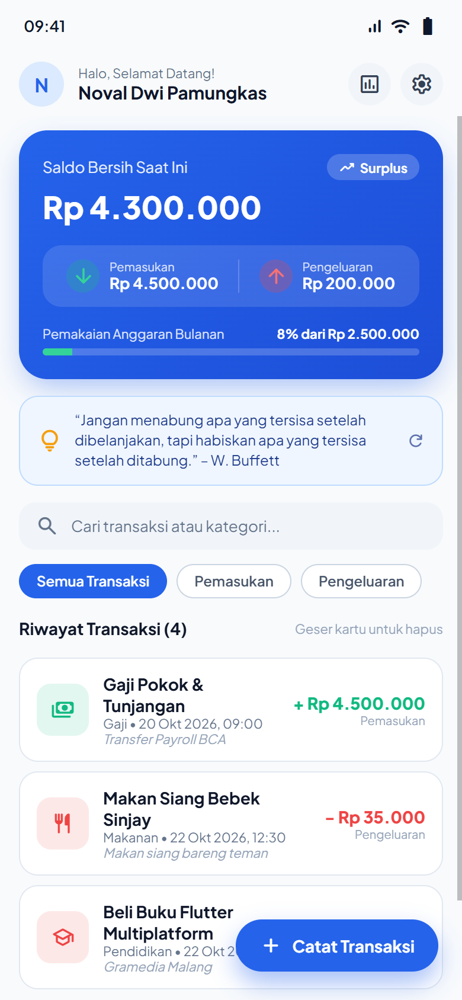
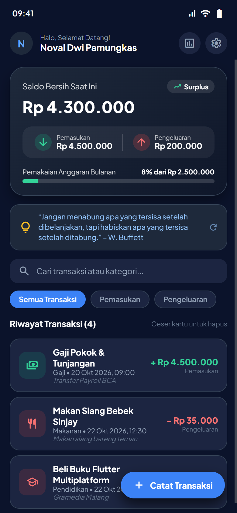
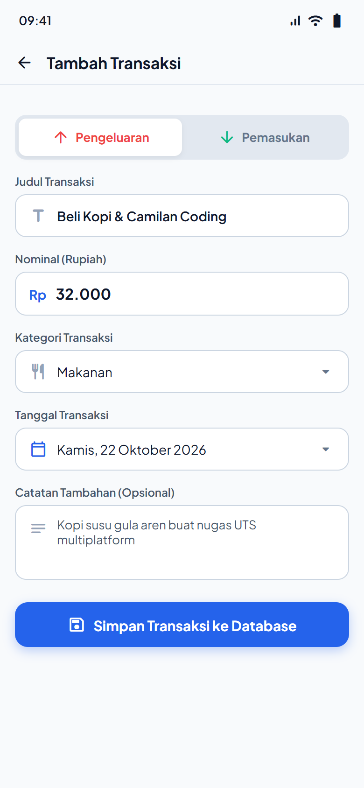
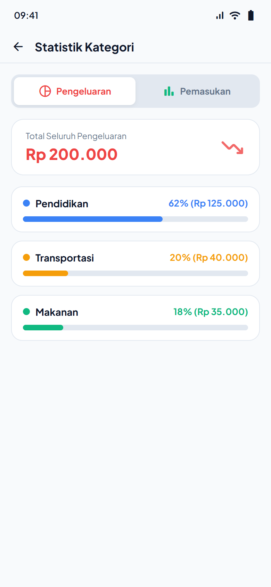
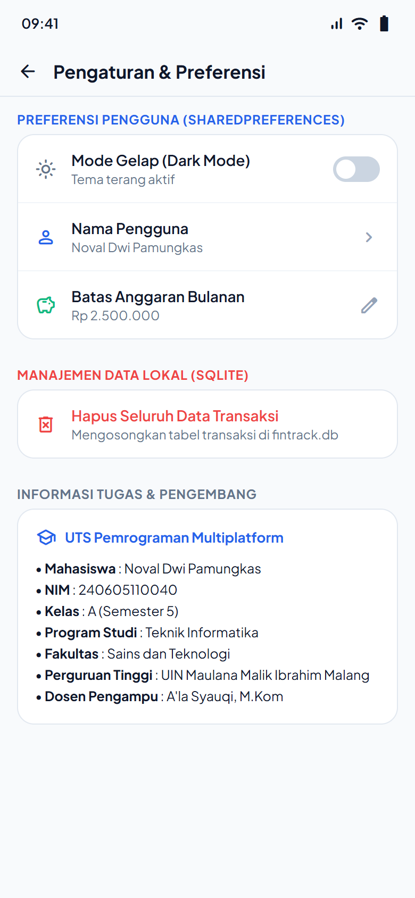

# FinTrack 💰 - Aplikasi Catatan Keuangan Multiplatform

> **Tugas Ujian Tengah Semester (UTS) Pemrograman Multiplatform (Kelas A)**  
> **Dosen Pengampu:** A'la Syauqi, M.Kom  
> **Pengembang:** Noval Dwi Pamungkas  
> **NIM:** 240605110040  
> **Program Studi:** S1 Teknik Informatika  
> **Fakultas:** Sains dan Teknologi  
> **Perguruan Tinggi:** Universitas Islam Negeri Maulana Malik Ibrahim Malang  
> **Tahun Ajaran:** 2026/2027  

---

## 📌 Deskripsi Aplikasi
**FinTrack** adalah aplikasi pencatatan keuangan pribadi modern berbasis **Flutter & Dart** yang dirancang secara *offline-first*. Aplikasi ini membantu pengguna dalam mencatat, mengelola, dan memantau arus kas harian (pemasukan dan pengeluaran) secara efisien dan terstruktur.

Aplikasi mengimplementasikan standar arsitektur bersih (*Clean & Modular Architecture*) serta memenuhi seluruh indikator capaian UTS:
1. **Asynchronous Programming**: Penanganan operasi I/O dan simulasi layanan eksternal menggunakan `Future`, `async`, dan `await`.
2. **Data Persistence 1 (SharedPreferences)**: Penyimpanan preferensi ringan berpasangan *key-value* (status Dark Mode, nama profil pengguna, dan batas anggaran bulanan).
3. **Data Persistence 2 (SQLite)**: Penyimpanan basis data lokal terstruktur menggunakan query SQL relasional (CRUD transaksi, agregasi saldo, filter, dan visualisasi statistik).

---

## 📱 Tangkapan Layar (Screenshots)

| Dashboard (Light Mode) | Dashboard (Dark Mode) | Form Tambah Transaksi |
| :---: | :---: | :---: |
|  |  |  |

| Statistik Kategori | Pengaturan & Preferensi |
| :---: | :---: |
|  |  |

---

## ✨ Fitur Utama
1. **Dashboard Arus Kas Dinamis**:
   - Card ringkasan total saldo bersih, total pemasukan, dan total pengeluaran secara *real-time*.
   - Progress bar indikator pemakaian anggaran belanja bulanan.
2. **Pencatatan Transaksi Lengkap (CRUD SQLite)**:
   - **Create**: Tambah catatan pemasukan/pengeluaran baru dengan kategori, tanggal kustom, nominal Rupiah, dan catatan detail.
   - **Read**: Tampilan daftar transaksi dengan pengurutan kronologis terbaru (`date DESC`).
   - **Update**: Edit transaksi dengan mengetuk kartu riwayat transaksi.
   - **Delete**: Hapus transaksi dengan fitur *Swipe to Dismiss* yang dilengkapi dialog konfirmasi.
3. **Pencarian Realtime & Filter Kategori**:
   - Filter cepat berdasarkan status (*Semua Transaksi*, *Pemasukan*, *Pengeluaran*).
   - Fitur pencarian instan pada judul atau nama kategori.
4. **Visualisasi Statistik Kategori**:
   - Persentase alokasi pengeluaran dan pemasukan per kategori dengan visual bar progresif.
5. **Banner Edukasi Finansial (Asynchronous Simulation)**:
   - Tips dan motivasi bijak keuangan yang dimuat secara asinkron dengan tombol pembaruan (*refresh*).
6. **Preferensi Pengguna Persisten (SharedPreferences)**:
   - Pengalihan mode tema gelap (*Dark Mode*) dan terang (*Light Mode*) yang tersimpan otomatis.
   - Kustomisasi nama pengguna untuk salam personal di dashboard.
   - Pengaturan batas anggaran belanja bulanan (*Monthly Budget Alert*).
7. **Fitur Reset Database**:
   - Kemampuan membersihkan seluruh riwayat transaksi dengan proteksi dialog konfirmasi.

---

## ⚡ Implementasi Asynchronous Programming
Seluruh operasi I/O yang berpotensi memblokir *UI thread* (*Jank*) ditangani secara non-blocking dengan konsep asinkron:
- **`Future<Database>` & `async/await`**:
  Pada berkas `lib/services/database_helper.dart`, inisialisasi basis data `_initDB` serta seluruh method transaksi (`insertTransaction`, `getAllTransactions`, `updateTransaction`, `deleteTransaction`, `getSummaryTotals`, `getCategoryBreakdown`) dijalankan secara asinkron.
- **`Future.wait`**:
  Pada `lib/screens/home_screen.dart`, inisialisasi awal aplikasi memuat preferensi SharedPreferences, data SQLite, dan tips keuangan secara simultan dan paralel:
  ```dart
  await Future.wait([
    _loadPreferences(),
    _loadTransactions(),
    _loadDailyQuote(),
  ]);
  ```
- **Simulasi Latensi Jaringan (`Future.delayed`)**:
  Pada `lib/services/quote_service.dart`, simulasi pemanggilan API eksternal menggunakan `await Future.delayed(const Duration(milliseconds: 800))` guna menguji respon aplikasi dan *loading indicator*.

---

## 💾 Implementasi Data Persistence
Aplikasi menerapkan **2 (dua) teknik penyimpanan data** sesuai ketentuan:

### 1. SharedPreferences (Key-Value Storage)
Digunakan untuk data preferensi status aplikasi:
| Key | Tipe Data | Deskripsi |
| :--- | :--- | :--- |
| `is_dark_mode` | `bool` | Preferensi tema aplikasi (True = Gelap, False = Terang) |
| `user_name` | `String` | Nama profil pengguna (salam pada AppBar) |
| `monthly_budget` | `double` | Target batas anggaran belanja bulanan |

### 2. SQLite / Sqflite (Structured Database)
Digunakan untuk data relasional transaksi keuangan pada tabel `transactions`:
```sql
CREATE TABLE transactions (
  id INTEGER PRIMARY KEY AUTOINCREMENT,
  title TEXT NOT NULL,
  amount REAL NOT NULL,
  type TEXT NOT NULL,
  category TEXT NOT NULL,
  date TEXT NOT NULL,
  note TEXT
);
```

---

## 📂 Struktur Berkas Project
```
fintrack_app/
├── lib/
│   ├── main.dart                             # Entry point, inisialisasi ffi, theme mode
│   ├── models/
│   │   └── transaction_model.dart            # Model data transaksi, toMap & fromMap
│   ├── services/
│   │   ├── database_helper.dart              # SQLite helper (CRUD & agregasi async)
│   │   ├── preference_service.dart           # SharedPreferences helper (Key-Value)
│   │   └── quote_service.dart                # Async external quote simulation
│   ├── screens/
│   │   ├── home_screen.dart                  # Dashboard utama & riwayat transaksi
│   │   ├── add_edit_transaction_screen.dart  # Form input & update transaksi
│   │   ├── statistics_screen.dart            # Visualisasi persentase kategori
│   │   └── settings_screen.dart              # Pengaturan tema, nama, budget, reset
│   └── widgets/
│       ├── summary_card.dart                 # Kartu ringkasan saldo & progress bar
│       └── transaction_card.dart             # Kartu riwayat transaksi & dismissible
├── test/
│   ├── full_feature_test.dart                # Unit & Integration test otomatis
│   └── widget_test.dart                      # Model & async test
├── screenshots/                              # Bukti visual antarmuka aplikasi
├── pubspec.yaml                              # Konfigurasi dependensi project
└── README.md                                 # Dokumentasi teknis proyek
```

---

## 📦 Package yang Digunakan
| Package | Versi | Alasan & Fungsi Penggunaan |
| :--- | :--- | :--- |
| `sqflite` | `^2.4.5` | Menyediakan engine basis data SQLite relasional untuk platform Android & iOS |
| `sqflite_common_ffi` | `^2.4.4` | Mendukung engine SQLite pada desktop (Windows/Linux) dan lingkungan unit testing |
| `shared_preferences` | `^2.5.6` | Menyimpan preferensi konfigurasi pengguna berbasis pasangan *key-value* secara persisten |
| `path_provider` | `^2.1.6` | Menemukan path direktori sistem yang tepat untuk lokasi basis data lokal perangkat |
| `path` | `^1.9.1` | Memanipulasi dan menggabungkan path direktori secara aman lintas sistem operasi |
| `intl` | `^0.20.3` | Format mata uang Rupiah (`id_ID`) dan format waktu/tanggal lokal Indonesia |

---

## 🚀 Langkah Menjalankan Aplikasi

### 1. Prasyarat
- Flutter SDK (versi >= 3.13.0)
- Dart SDK (versi >= 3.0.0)
- Perangkat Android, Emulator, atau Chrome Browser

### 2. Kloning Repositori
```bash
git clone https://github.com/<username>/fintrack_app.git
cd fintrack_app
```

### 3. Mengunduh Dependencies
```bash
flutter pub get
```

### 4. Menjalankan Pengujian Otomatis
```bash
flutter test
```

### 5. Menjalankan Aplikasi
- **Pada Emulator / HP Android**:
  ```bash
  flutter run
  ```
- **Pada Chrome Web**:
  ```bash
  flutter run -d chrome
  ```
- **Pada Desktop Windows**:
  ```bash
  flutter run -d windows
  ```

---

## 🧪 Hasil Pengujian Fungsionalitas
| No | Fitur yang Diuji | Langkah Pengujian | Hasil yang Diharapkan | Hasil Aktual | Status |
| :---: | :--- | :--- | :--- | :--- | :---: |
| 1 | **Fitur Utama (CRUD)** | Tambah, baca, ubah, dan hapus transaksi keuangan pada form | Data berhasil tersimpan, terupdate, dan terhapus dari tabel transaksi | Data masuk dan terhapus secara akurat | **BERHASIL** |
| 2 | **Proses Asinkron** | Menjalankan pemanggilan data SQLite, SharedPreferences, dan quote tips | UI tetap responsif tanpa freeze, loading indicator muncul saat proses | Operasi selesai di background dan data tampil mulus | **BERHASIL** |
| 3 | **Penyimpanan SQLite** | Memasukkan transaksi baru lalu me-refresh halaman beranda | Data transaksi tetap ada dan dihitung dalam ringkasan saldo | Data terbaca kembali lengkap dengan nominal & tanggal | **BERHASIL** |
| 4 | **Penyimpanan SharedPreferences** | Mengubah mode gelap dan nama pengguna | Preferensi tema langsung berganti dan nama tersimpan | Status switch dan nama pengguna tersimpan permanen | **BERHASIL** |
| 5 | **Persistensi Data (Offline & Reboot)** | Menutup paksa aplikasi (*kill process*) dan membuka kembali | Semua data transaksi SQLite dan tema SharedPreferences tetap ada | Data tidak hilang saat aplikasi ditutup | **BERHASIL** |

---

*Disusun untuk memenuhi Tugas Ujian Tengah Semester (UTS) Mata Kuliah Pemrograman Multiplatform TA 2026/2027.*
